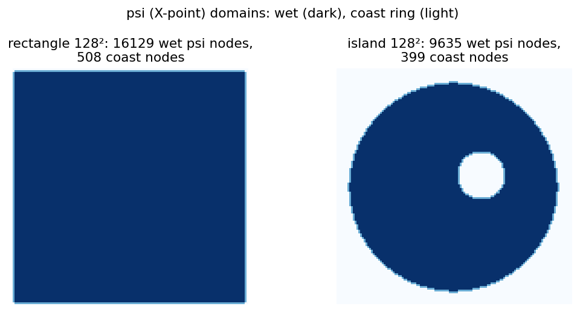
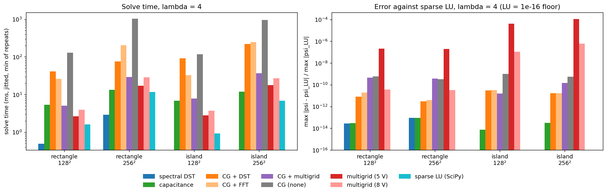
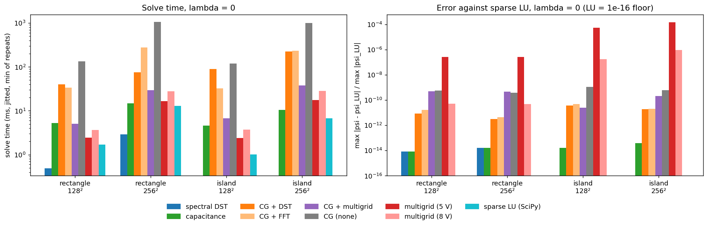
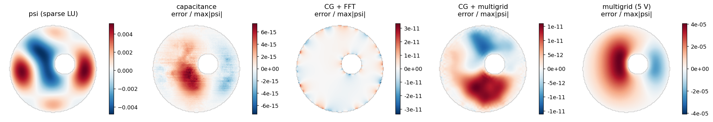

# Solver Comparison

This page compares finitevolX's elliptic solvers on the problem they all
solve — the streamfunction Helmholtz equation on the C-grid,

$$
(\nabla^2 - \lambda)\,\psi = f \ \text{ on the wet X points},
\qquad \psi = 0 \ \text{ on the wall / coast X nodes},
$$

(see the [wall table](elliptic_solvers.md#boundary-conditions)) — with
**measured** numbers: build time, solve time, gradient time, iteration
counts, memory and error against a sparse direct solve.

!!! note "Reproducing these numbers"
    Every number and figure on this page comes from
    `scripts/generate_solver_figures.py`:

    ```bash
    uv run python scripts/generate_solver_figures.py
    ```

    **Hardware:** a 2-vCPU cloud VM, XLA:CPU, float64, JAX 0.10.1, shared
    with other jobs while it ran.  Iteration counts and errors are
    deterministic; timings are the **minimum** over 7 jitted calls (3 for
    gradients; builds: minimum of 2, multigrid builds minimum of 7 in a later run after a build-speed fix) and still vary by tens of percent
    between runs.  Compare orders of magnitude and ratios, not the third
    digit.  On a GPU the balance shifts towards the FFT-based and
    matrix-free methods.

For a visual walk-through of the solvers on four geometries (including a
variable-coefficient one), see the
[Elliptic Solvers notebook](notebooks/demo_solvers.py).

---

## Setup



| | |
|---|---|
| **Domains** | the unit square (`CartesianGrid2D.from_interior(N, N, 1, 1)`); a **rectangle**, and a **circular basin** of radius 0.45 with a disc **island** of radius 0.1, both as `Mask2D` from a T-point ocean mask; ψ uses `mask.xy_corner_strict` |
| **Sizes** | $N = 128$ and $256$ interior cells per side (arrays $(N+2)^2$; 16 129 / 65 025 wet ψ nodes on the rectangle, 9 635 / 39 063 in the island basin; 508 / 1 020 and 399 / 795 coast nodes) |
| **λ** | 4 (screened, $R_d = 0.5$) and 0 (Poisson) |
| **RHS** | $f = \sin 3\pi x \cos 2\pi y + e^{-[(x-0.3)^2 + (y-0.7)^2]/0.01}$ on the wet nodes |
| **Reference** | SciPy sparse LU (SuperLU) of the 5-point matrix on the wet nodes — the matrix of `masked_laplacian`; its residual is checked to round-off |
| **Error** | $\max\lvert\psi - \psi_{\text{LU}}\rvert / \max\lvert\psi_{\text{LU}}\rvert$ |
| **CG tolerance** | `rtol = 1e-8`, `atol = 1e-8 max|f|`, i.e. $\max\lvert f - A\psi\rvert \le 2\times10^{-8} \max\lvert f\rvert$ |

The methods:

| Row | Call |
|---|---|
| spectral DST | `streamfunction_from_vorticity(f, dx, dy, bc="dst", lambda_=λ)` (rectangle only) |
| capacitance | `build_capacitance_solver(mask, dx, dy, lambda_=λ)` (DST base), then `solver(f)` |
| CG + DST / FFT | `solve_cg(masked_laplacian, f, preconditioner=make_spectral_preconditioner(dx, dy, λ, bc=...))` |
| CG + multigrid | the same with `make_multigrid_preconditioner(build_multigrid_solver(mask, dx, dy, lambda_=λ))` |
| CG (none) | no preconditioner |
| multigrid (5 V / 8 V) | the multigrid solver on its own, 5 V-cycles (the default) or 8 |
| sparse LU (SciPy) | the reference; NumPy on the CPU — no `jit`, `vmap` or `grad` |

The columns: **build** is the one-off construction (NumPy / SciPy, not
jitted); **solve** is one jitted solve; **grad** is one jitted
`jax.grad` of $\tfrac12\sum\psi^2$ with respect to $f$ (forward plus
adjoint solve); **precomputed** is the memory of the arrays the built
solver holds (for sparse LU, the factors).

---

## Results

### λ = 4



| domain | N | method | build (ms) | solve (ms) | grad (ms) | iterations | precomputed | max error |
|---|---|---|--:|--:|--:|--:|--:|--:|
| rectangle | 128² | sparse LU (SciPy) | 52.2 | 1.62 | — | direct | 14 MiB | 0.0e+00 |
| rectangle | 128² | spectral DST | — | 0.493 | 1.3 | direct | — | 2.9e-14 |
| rectangle | 128² | capacitance | 2,044 | 5.39 | 11 | direct | 2.3 MiB | 2.9e-14 |
| rectangle | 128² | CG + DST | — | 41.4 | 70 | 15 it | — | 8.3e-12 |
| rectangle | 128² | CG + FFT | — | 26 | 44.4 | 31 it | — | 1.9e-11 |
| rectangle | 128² | CG + multigrid | 20.4 | 5.02 | 12.9 | 5 it | 1.6 MiB | 4.4e-10 |
| rectangle | 128² | CG (none) | — | 128 | 234 | 365 it | — | 5.8e-10 |
| rectangle | 128² | multigrid (5 V) | 20.4 | 2.65 | 6.22 | 5 V | 1.6 MiB | 2.1e-07 |
| rectangle | 128² | multigrid (8 V) | 20.4 | 3.91 | 8.3 | 8 V | 1.6 MiB | 3.6e-11 |
| rectangle | 256² | sparse LU (SciPy) | 322 | 11.7 | — | direct | 72 MiB | 0.0e+00 |
| rectangle | 256² | spectral DST | — | 2.92 | 6.18 | direct | — | 8.9e-14 |
| rectangle | 256² | capacitance | 5,326 | 13.4 | 27.2 | direct | 9.1 MiB | 8.9e-14 |
| rectangle | 256² | CG + DST | — | 76.2 | 137 | 15 it | — | 2.9e-12 |
| rectangle | 256² | CG + FFT | — | 204 | 367 | 47 it | — | 3.9e-12 |
| rectangle | 256² | CG + multigrid | 57.6 | 29 | 55 | 5 it | 6.1 MiB | 3.7e-10 |
| rectangle | 256² | CG (none) | — | 1,037 | 1,988 | 748 it | — | 3.3e-10 |
| rectangle | 256² | multigrid (5 V) | 57.6 | 17 | 36 | 5 V | 6.1 MiB | 2.0e-07 |
| rectangle | 256² | multigrid (8 V) | 57.6 | 28.8 | 57 | 8 V | 6.1 MiB | 3.3e-11 |
| island | 128² | sparse LU (SciPy) | 27.4 | 0.935 | — | direct | 7.1 MiB | 0.0e+00 |
| island | 128² | capacitance | 1,917 | 6.8 | 9.91 | direct | 1.5 MiB | 7.4e-15 |
| island | 128² | CG + DST | — | 91.2 | 158 | 35 it | — | 3.0e-11 |
| island | 128² | CG + FFT | — | 32.7 | 59.2 | 41 it | — | 3.3e-11 |
| island | 128² | CG + multigrid | 20.9 | 7.77 | 14 | 7 it | 1.6 MiB | 1.6e-11 |
| island | 128² | CG (none) | — | 116 | 249 | 339 it | — | 1.0e-09 |
| island | 128² | multigrid (5 V) | 20.9 | 2.81 | 4.73 | 5 V | 1.6 MiB | 4.1e-05 |
| island | 128² | multigrid (8 V) | 20.9 | 3.72 | 8.54 | 8 V | 1.6 MiB | 1.1e-07 |
| island | 256² | sparse LU (SciPy) | 181 | 6.89 | — | direct | 41 MiB | 0.0e+00 |
| island | 256² | capacitance | 4,174 | 12 | 22.2 | direct | 5.8 MiB | 3.2e-14 |
| island | 256² | CG + DST | — | 218 | 421 | 47 it | — | 1.7e-11 |
| island | 256² | CG + FFT | — | 247 | 420 | 56 it | — | 1.7e-11 |
| island | 256² | CG + multigrid | 47.6 | 36.9 | 76 | 7 it | 6.1 MiB | 1.5e-10 |
| island | 256² | CG (none) | — | 961 | 1,772 | 695 it | — | 5.4e-10 |
| island | 256² | multigrid (5 V) | 47.6 | 17.8 | 35.4 | 5 V | 6.1 MiB | 1.1e-04 |
| island | 256² | multigrid (8 V) | 47.6 | 27.2 | 54.1 | 8 V | 6.1 MiB | 5.9e-07 |

### λ = 0 (Poisson)



| domain | N | method | build (ms) | solve (ms) | grad (ms) | iterations | precomputed | max error |
|---|---|---|--:|--:|--:|--:|--:|--:|
| rectangle | 128² | sparse LU (SciPy) | 47.3 | 1.69 | — | direct | 14 MiB | 0.0e+00 |
| rectangle | 128² | spectral DST | — | 0.488 | 1.32 | direct | — | 8.2e-15 |
| rectangle | 128² | capacitance | 2,133 | 5.27 | 10.9 | direct | 2.3 MiB | 8.3e-15 |
| rectangle | 128² | CG + DST | — | 40.4 | 72.3 | 15 it | — | 8.4e-12 |
| rectangle | 128² | CG + FFT | — | 33.5 | 60.9 | 41 it | — | 1.7e-11 |
| rectangle | 128² | CG + multigrid | 21.1 | 5.11 | 10.9 | 5 it | 1.6 MiB | 5.0e-10 |
| rectangle | 128² | CG (none) | — | 134 | 238 | 373 it | — | 5.7e-10 |
| rectangle | 128² | multigrid (5 V) | 21.1 | 2.47 | 5.31 | 5 V | 1.6 MiB | 2.7e-07 |
| rectangle | 128² | multigrid (8 V) | 21.1 | 3.68 | 9.69 | 8 V | 1.6 MiB | 5.0e-11 |
| rectangle | 256² | sparse LU (SciPy) | 334 | 13 | — | direct | 72 MiB | 0.0e+00 |
| rectangle | 256² | spectral DST | — | 2.91 | 5.91 | direct | — | 1.6e-14 |
| rectangle | 256² | capacitance | 5,240 | 14.8 | 26.3 | direct | 9.1 MiB | 1.6e-14 |
| rectangle | 256² | CG + DST | — | 75.3 | 135 | 15 it | — | 3.0e-12 |
| rectangle | 256² | CG + FFT | — | 274 | 503 | 63 it | — | 4.3e-12 |
| rectangle | 256² | CG + multigrid | 56.7 | 29.4 | 54.3 | 5 it | 6.1 MiB | 4.5e-10 |
| rectangle | 256² | CG (none) | — | 1,065 | 1,988 | 762 it | — | 3.8e-10 |
| rectangle | 256² | multigrid (5 V) | 56.7 | 16.5 | 33.3 | 5 V | 6.1 MiB | 2.6e-07 |
| rectangle | 256² | multigrid (8 V) | 56.7 | 27.9 | 41 | 8 V | 6.1 MiB | 4.7e-11 |
| island | 128² | sparse LU (SciPy) | 26.9 | 1.01 | — | direct | 7.1 MiB | 0.0e+00 |
| island | 128² | capacitance | 1,895 | 4.63 | 9.94 | direct | 1.5 MiB | 1.6e-14 |
| island | 128² | CG + DST | — | 90.3 | 157 | 35 it | — | 3.6e-11 |
| island | 128² | CG + FFT | — | 32.7 | 58.6 | 39 it | — | 4.7e-11 |
| island | 128² | CG + multigrid | 20.8 | 6.7 | 13.1 | 7 it | 1.6 MiB | 2.5e-11 |
| island | 128² | CG (none) | — | 120 | 214 | 343 it | — | 1.1e-09 |
| island | 128² | multigrid (5 V) | 20.8 | 2.42 | 4.95 | 5 V | 1.6 MiB | 5.5e-05 |
| island | 128² | multigrid (8 V) | 20.8 | 3.75 | 9.85 | 8 V | 1.6 MiB | 1.8e-07 |
| island | 256² | sparse LU (SciPy) | 191 | 6.8 | — | direct | 41 MiB | 0.0e+00 |
| island | 256² | capacitance | 4,434 | 10.5 | 22.1 | direct | 5.8 MiB | 3.8e-14 |
| island | 256² | CG + DST | — | 226 | 421 | 48 it | — | 1.9e-11 |
| island | 256² | CG + FFT | — | 232 | 428 | 55 it | — | 2.0e-11 |
| island | 256² | CG + multigrid | 46.7 | 37.9 | 73.7 | 7 it | 6.1 MiB | 2.1e-10 |
| island | 256² | CG (none) | — | 994 | 1,779 | 700 it | — | 5.9e-10 |
| island | 256² | multigrid (5 V) | 46.7 | 17.7 | 34.5 | 5 V | 6.1 MiB | 1.5e-04 |
| island | 256² | multigrid (8 V) | 46.7 | 28.2 | 56.9 | 8 V | 6.1 MiB | 9.3e-07 |

### Where the error sits



Island basin, 128², λ = 4: the solution, then the error of capacitance
(round-off), CG + FFT and CG + multigrid (the CG tolerance) and 5
multigrid V-cycles (largest next to the island).

---

## What the numbers say

- **Every method solves the same problem.**  The direct methods agree
  with sparse LU to $10^{-14}$, CG to its tolerance ($10^{-11}$–$10^{-9}$),
  on both domains: one wall, one operator.
- **Rectangle: spectral wins.**  The DST solve takes 0.5 / 2.9 ms at
  128² / 256², 3–4.5× faster than SciPy's sparse LU and at least 5× faster
  than any other JAX solver, with nothing to build.
- **Fixed mask: capacitance is exact and the fastest masked solve at
  256².**  4.6–15 ms per solve: as fast as CG + multigrid at 128² and
  2–3.6× faster at 256², after a 1.9–5.3 s build that stores 1.5–9 MiB
  ($N_c^2$ for 400–1 020 coast nodes).  It pays off
  when the same mask and λ are reused many times.
- **CG + multigrid is the fastest CG, at any size.**  5 iterations on the
  rectangle and 7 in the island basin at both 128² and 256² (the count
  does not grow with $N$), 5–38 ms, with 1.6–6.1 MiB: 2.6–6.6× faster
  than the best spectral-preconditioned CG.  The hierarchy builds in
  20–58 ms on both domains, cheap enough to rebuild when the mask or λ
  changes.
- **Spectral preconditioners need no setup, but their iterations grow with
  $N$:** 31–63 with the FFT, 15–48 with the DST (on the rectangle the DST
  differs from the C-grid operator only at the array edge, so it stays at
  15).  At 128² a DST step costs ~3× an FFT step on XLA:CPU, so CG + FFT is
  often faster despite more iterations; at 256² the two steps cost about
  the same.  Unpreconditioned CG takes 340–760 iterations (0.1–1.1 s).
- **Standalone multigrid is the cheapest iterative solve** (2.4–2.8 ms /
  16.5–18 ms), but its accuracy depends on the geometry: 5 V-cycles (the
  default) give $2$–$3\times10^{-7}$ on the rectangle but
  $4\times10^{-5}$–$1.5\times10^{-4}$ in the island basin; 8 cycles give
  $\le 5\times10^{-11}$ and $10^{-7}$–$10^{-6}$.  Wrap it in CG when you need a tolerance.
- **λ = 0 costs nothing extra.**  The ψ wall is Dirichlet, so the Poisson
  problem is non-singular for every method; only the FFT preconditioner
  takes more iterations (41 / 63 vs 31 / 47 on the rectangle).
- **Gradients cost about one more solve.**  For every JAX method, `grad`
  takes 1.5–2.7× the forward solve: the adjoint of a symmetric solve is the
  same solve.
- **Jit the solver as an argument, not a closure.**  Closing over a built
  solver embeds its arrays in the program as constants, which XLA then
  constant-folds: compiling the closed-over capacitance solve of the 256²
  island basin took 8 minutes.  Pass it in
  (`eqx.filter_jit(lambda s, f: s(f))(solver, f)`), as the script does.

---

## Dense, tridiagonal or sparse? (#201)

#201 asked whether the elliptic problems should be solved with a full
(dense) matrix, a tridiagonal one or a sparse one.  For the 2-D C-grid
problem at these sizes:

- **Dense** is out: the 5-point matrix has $n$ = 16 129 / 65 025 unknowns
  on the rectangle, so the matrix alone is 2 GiB / 32 GiB in float64 and
  its LU costs $O(n^3)$.  The *useful* dense matrix is the capacitance
  matrix: dense only on the $N_c$ coast nodes (1.5–9 MiB here), with the
  bulk handled by the fast rectangular solve.
- **Tridiagonal** does not apply directly: the 2-D 5-point operator is
  block tridiagonal, not tridiagonal.  `solve_tridiagonal` (gaussx) is for
  1-D and vertical problems (implicit vertical diffusion, layer coupling);
  the fast rectangular 2-D solve is the spectral one.
- **Sparse direct** (SciPy SuperLU, the reference rows): fast on a CPU —
  0.9–13 ms per solve after a 27–334 ms factorisation — but its fill-in takes
  7–72 MiB (4–12× the multigrid hierarchy) and it runs outside JAX: no `jit`,
  `vmap`, `grad` or GPU.  The JAX-native sparse route is matrix-free: CG on
  `masked_laplacian` (nothing stored) with the multigrid preconditioner
  (1.6–6.1 MiB), differentiable at about twice the solve cost.

---

## When to Use What

```
Rectangle, constant coefficient?
├── Yes → Spectral (method="spectral"): exact, fastest
└── No (masked) ↓

Fixed mask and λ, many solves, setup affordable?
├── Yes → Capacitance (method="capacitance"): exact, a few ms per solve
└── No (the mask or λ changes, or a very long coastline) ↓

Need the CG tolerance (or a variable coefficient)?
├── Yes → CG + multigrid preconditioner: 5–7 iterations, any size
└── No → Multigrid alone: a few V-cycles, the cheapest iterative solve
          (more cycles near islands / narrow channels)

No setup at all → CG with the default spectral preconditioner
                  (iterations grow with N)
```

---

## References

- [Elliptic Solvers — Theory](elliptic_solvers.md): spectral theory, capacitance
  method, preconditioners
- [Elliptic Solvers — Usage](elliptic_solvers_usage.md): code examples for all
  solvers
- [Multigrid Solver — Theory](multigrid_solver.md): V-cycle algorithm, variable
  coefficients, differentiation strategies
- [Multigrid Solver — Usage](multigrid_solver_usage.md): building, solving,
  tuning
